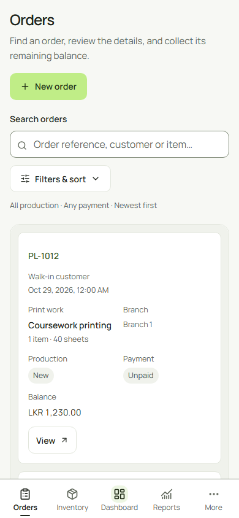
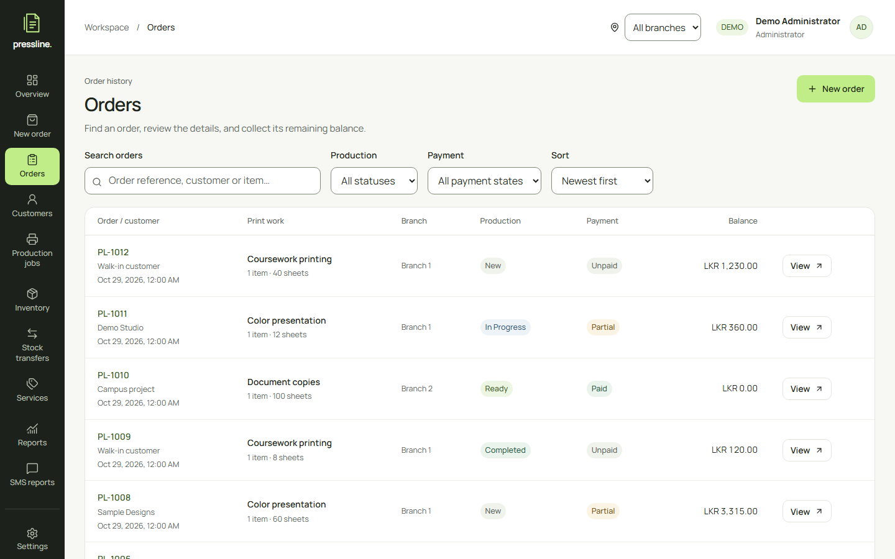
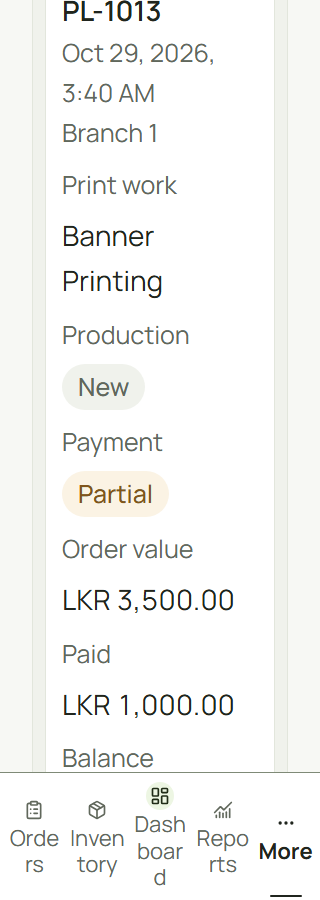
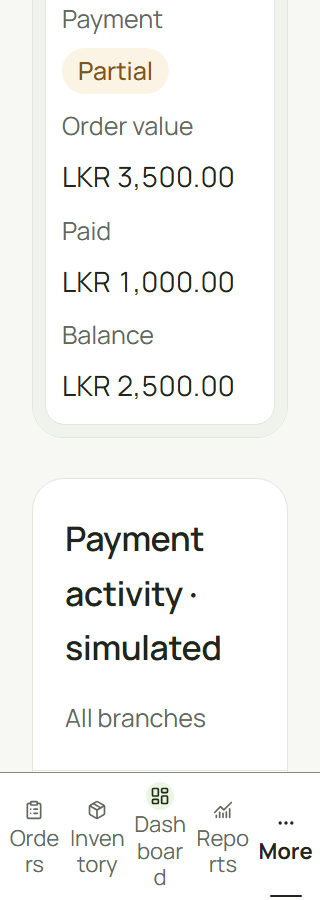

# Optimization verification evidence

Application source: hosted candidate cb10f459bffd0203ffad9ea8c0445cbd729ca1eb. Final source integration/remote Actions are recorded in the release PR and final delivery; this snapshot precedes its own commit. Full interpretation and limitations: [ten-part report](../../frontend-optimization.md).

## Executed checks

- [Hosted candidate](hosted-candidate-summary.json): 274 browser passes / two unsupported CDP skips; all three strict-gate jobs pass.
- [Failed first local matrix summary](diagnostic-browser-summary.json) and [compressed raw report](diagnostic-browser-matrix.json.gz): failures remain failed.
- [Original quantity-click evidence](quantity-click-before.json), [local axe injection failure](axe-injection-diagnostic.json) and [local locator injection failure](locator-injection-diagnostic.json).
- [More animation timing evidence](more-animation-timing.json): retain the failed final-integration contrast observation and actual stable-scan boundary; no palette/motion/rule change.
- [Final touch/pointer smoke](mobile-engine-smoke.json), [source/runtime design probes](design-probes.json), [pixel comparisons](card-image-comparisons.json).
- [Actual advisory result](npm-audit-final.json) and [bounded secret-scan evidence](secret-scan-summary.json). These are not a full security audit.

## Performance

- [Initial aggregate assets](baseline-bundle.json), [cleanup checkpoint](cleanup-bundle.json), [final assets](final-bundle.json). No bundle reduction claim.
- [Baseline runtime](baseline-runtime.json), [final runtime](final-runtime.json): matching six-navigation lab conditions; not field INP or a causal speedup.
- [Navigation request comparison](navigation-request-summary.json), [before raw](navigation-before.json.gz), [after raw](navigation-after.json.gz): speculative requests 74 to zero per engine, request events 215 to 108. Events are not guaranteed network round trips.
- [Initial mobile diagnostic](baseline-lighthouse-summary.json), [valid pre-cleanup mobile/desktop](pre-cleanup-lighthouse-summary.json), [final mobile/desktop](final-lighthouse-summary.json). Final mobile performance 83/82/88/96; desktop 100 throughout; other three categories 100. Mobile 90 aim is unmet on three routes. One sample per route, local simulated conditions.

Compressed Lighthouse JSON files retain the full raw reports. Initial wrongly configured desktop attempts were rejected and are not included. Representative raw final reports: [mobile POS](final-lighthouse-mobile-pos.json.gz), [desktop POS](final-lighthouse-desktop-pos.json.gz), [mobile login](final-lighthouse-mobile-login.json.gz).

## Visual review

Actual production screenshots; no image editing. Normal phone/desktop captures report no page errors, failed requests or external requests. All sixteen match the pre-enlargement/prefetch card checkpoint pixel-for-pixel. The 320px/200% history captures show the corrected readable word/status/amount layout after dismissing a genuine notification. The navigation labels retain their existing enlarged-text wrapping and centered Dashboard.

| Screen    | Phone 390px                        | Desktop 1440px                      |
| --------- | ---------------------------------- | ----------------------------------- |
| dashboard | [capture](dashboard-cards-390.png) | [capture](dashboard-cards-1440.png) |
| orders    | [capture](orders-cards-390.png)    | [capture](orders-cards-1440.png)    |
| jobs      | [capture](jobs-cards-390.png)      | [capture](jobs-cards-1440.png)      |
| customers | [capture](customers-cards-390.png) | [capture](customers-cards-1440.png) |
| inventory | [capture](inventory-cards-390.png) | [capture](inventory-cards-1440.png) |
| pricing   | [capture](pricing-cards-390.png)   | [capture](pricing-cards-1440.png)   |
| transfers | [capture](transfers-cards-390.png) | [capture](transfers-cards-1440.png) |
| settings  | [capture](settings-cards-390.png)  | [capture](settings-cards-1440.png)  |

[Final capture observations](cards-visual-evidence.json); [before observations](cards-visual-before.json) retain 43 cancelled speculative requests separately from page exceptions. Physical hardware, assistive technology and printer output are not verified by these images.
